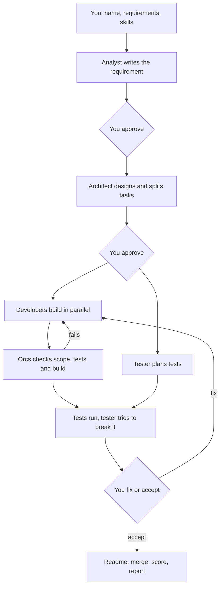

<!-- orcs:start -->
# Orcs

## Summary

Orcs delivers a software project with four AI agents, each running as its own clean Claude Code process.

- An analyst turns your request into a complete requirement.
- An architect picks the stack with you and splits the work into small tasks.
- Developers build the tasks in parallel, each in its own git worktree.
- A tester plans tests while developers build, then tries to break the result.

Agents never share chat history. Each one reads only the previous agent's JSON file. A plain script runs everything, so orchestration costs no tokens. You approve each step, answer short multiple-choice questions, and get a bug list, a token report and a score at the end.

## How it works



## Install

You need Node 22.18 or newer, git, and Claude Code signed in.

```bash
git clone git@github.com:piyushjha1234/orcs.git orcs
cd orcs
npm install
npm link
```

## How to use

1. Run `orcs new` and answer three questions: project name, requirements, and one optional line for skills. Add the word `global` on that line if agents should also use your global skills.
2. Answer the questions Orcs shows. Each has numbered options and a recommended one.
3. Watch progress on screen, or check from anywhere with `orcs status`.

Commands:

- `orcs new`: start a project.
- `orcs resume <id>`: continue a stopped run.
- `orcs status [id]`: see what is happening and what needs you.
- `orcs answer <id> <question> <choice>`: answer from another terminal, for example over SSH from your phone.
- `orcs list`: list all runs.
- `orcs bugs <id> [bug]`: show the bug list or one bug.
- `orcs report <id>`: show tokens, cost and score.
- `orcs ui [--port 4477] [--host 127.0.0.1] [--open] [--shortcut]`: open the orcs.ai web app. `--shortcut` puts Orcs on your Desktop. Double-click it to start the server in Terminal and open the site.

## Web app (orcs.ai)

`orcs ui` starts a small web app over the same run files, so you can follow a run, answer questions and approvals, read bugs and the report, start, resume and stop runs from a browser. It works on a phone too.

- By default it listens on `127.0.0.1` only. Double-click `Orcs` on the Desktop. Terminal starts the server, then the site opens in your browser. Leave that window open, and stop it with Ctrl-C. On this computer the site opens without the token. Other devices still need the token link.
- New run asks for a folder first, in a dialog. Open shows this computer’s folder window, including its New Folder button. The form then uses that folder.
- To use it from your phone on the same Wi-Fi, run `orcs ui --host 0.0.0.0`. The terminal then prints a link and a QR code. Both carry a random token, so anyone with the link can use the app: keep it private and stop the server when you are done.
- The app has no runtime dependencies and no build step. The browser code in `web/` is TypeScript, which the server converts to JavaScript as it serves each file.
- Settings (theme, announcements) are kept in that browser only. Keyboard shortcuts: `?` lists them.

Run data lives in `~/.orcs` (change it with `ORCS_HOME`). Each run keeps its agent files, `bug-report.csv` and `report.md` there.
<!-- orcs:end -->
