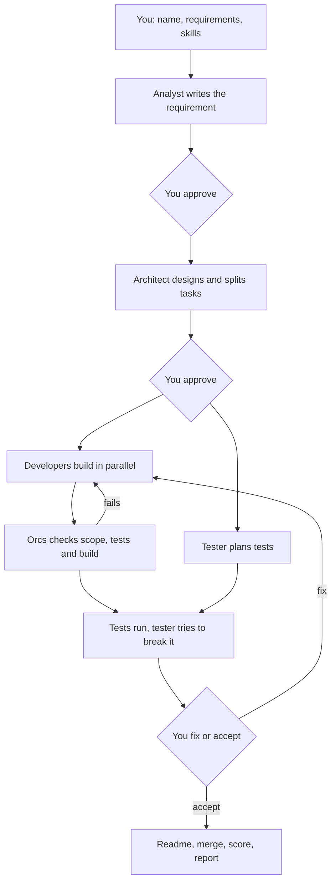

<!-- orcs:start -->
# Orcs

## Summary

Orcs delivers a software project with four AI agents, each running as its own clean Claude Code process.

- An analyst turns your request into a complete requirement.
- An architect picks the stack with you and splits the work into small tasks.
- Developers build the tasks in parallel, each in its own git worktree.
- A tester plans tests while developers build, then tries to break the result.

Agents never share chat history. Each one reads only the previous agent's JSON file. A plain script runs everything, so orchestration costs no tokens. You approve each step, answer short multiple-choice questions, and get a bug list, a token report and a score at the end.

## How it works



## Install

You need Node 22.18 or newer, git, and Claude Code signed in.

```bash
git clone <this repo> orcs
cd orcs
npm install
npm link
```

## How to use

1. Run `orcs new` and answer four questions: project name, requirements, the skills you want, and whether to use your global skills.
2. Answer the questions Orcs shows. Each has numbered options and a recommended one.
3. Watch progress on screen, or check from anywhere with `orcs status`.

Commands:

- `orcs new`: start a project.
- `orcs resume <id>`: continue a stopped run.
- `orcs status [id]`: see what is happening and what needs you.
- `orcs answer <id> <question> <choice>`: answer from another terminal, for example over SSH from your phone.
- `orcs list`: list all runs.
- `orcs bugs <id> [bug]`: show the bug list or one bug.
- `orcs report <id>`: show tokens, cost and score.

Run data lives in `~/.orcs` (change it with `ORCS_HOME`). Each run keeps its agent files, `bug-report.csv` and `report.md` there.
<!-- orcs:end -->
